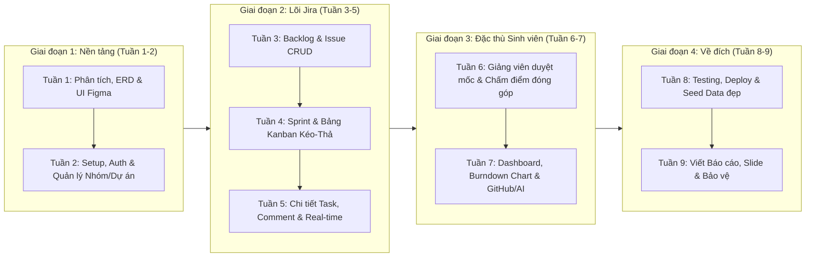

# Kế Hoạch 9 Tuần Thực Hiện Đồ Án Chuyên Ngành
**Đề tài:** Hệ thống quản lý dự án phần mềm dành cho nhóm sinh viên (Mô hình tương tự Jira)

---

## 1. Định Hình Đề Tài & Điểm Khác Biệt Cốt Lõi (Ăn Điểm Hội Đồng)

> [!IMPORTANT]
> **Câu hỏi chắc chắn hội đồng sẽ hỏi:** *"Tại sao nhóm sinh viên không dùng luôn Jira, Trello hay Notion mà phải dùng hệ thống của em?"*
> Để đạt điểm A/Giỏi, hệ thống của bạn phải giữ được **sức mạnh quản lý Agile/Scrum của Jira** nhưng giải quyết đúng **nỗi đau (pain points) đặc thù của sinh viên làm đồ án**:

| Vấn đề của Sinh viên khi dùng Jira | Giải pháp trong Hệ thống của bạn (Unique Selling Points) |
| :--- | :--- |
| **Jira quá phức tạp để cấu hình ban đầu** | **Academic Project Templates:** Khởi tạo dự án 1-click với mẫu có sẵn (Mẫu Đồ án 9 tuần, Mẫu Bài tập lớn 15 tuần, Mẫu Scrum chuẩn) kèm sẵn các cột và mốc báo cáo. |
| **Tình trạng "Gánh team" (Free-riding)** | **Contribution & Peer Evaluation:** Thống kê tự động tỷ lệ đóng góp (dựa trên Story Points, số task hoàn thành đúng hạn) + Đánh giá chéo ẩn danh cuối mỗi giai đoạn. |
| **Giảng viên khó theo dõi tiến độ thực tế** | **Vai trò Giảng viên hướng dẫn (Advisor Portal):** Giảng viên có giao diện theo dõi tổng quan các nhóm mình hướng dẫn, duyệt mốc báo cáo (Milestone Review) và để lại nhận xét trực tiếp. |
| **Lịch học tín chỉ mỗi thành viên khác nhau** | **Team Availability Matrix:** Bảng chọn khung giờ rảnh trong tuần của các thành viên để tự động gợi ý giờ họp nhóm chung. |

---

## 2. Kiến Trúc Công Nghệ Gợi Ý (Tech Stack)

Chọn bộ công nghệ phổ biến, nhiều thư viện hỗ trợ sẵn để kịp tiến độ 9 tuần:

* **Frontend:** React (Next.js hoặc Vite + TypeScript), **Tailwind CSS + shadcn/ui** (giúp dựng giao diện giống Jira cực nhanh), **`@hello-pangea/dnd`** hoặc **`@dnd-kit`** (kéo thả Kanban), **Recharts** (vẽ biểu đồ tiến độ), **TanStack Query / Zustand** (quản lý state).
* **Backend:** Node.js (**NestJS** hoặc **Express + TypeScript**) / hoặc **Spring Boot** / **.NET Core** (tùy ngôn ngữ thế mạnh của bạn).
* **Database:** **PostgreSQL** (hoặc MySQL) kết hợp **Prisma ORM** / **TypeORM**.
* **Real-time & Tích hợp:** **Socket.io** (cập nhật bảng Kanban & thông báo tức thời), **Cloudinary / Supabase Storage** (đính kèm file báo cáo, ảnh chụp lỗi), **GitHub Webhook** (tự động đính kèm commit/PR vào task).

---

## 3. Sơ Đồ Tổng Quan Lộ Trình 9 Tuần

---

## 4. Kế Hoạch Chi Tiết Từng Tuần (Tuần 1 $\rightarrow$ Tuần 9)

### Tuần 1: Khởi Động, Phân Tích Yêu Cầu & Thiết Kế Hệ Thống
**Mục tiêu:** Chốt phạm vi tính năng, hoàn thành cơ sở dữ liệu và bản vẽ giao diện (tránh vừa code vừa sửa).
* **Công việc cụ thể:**
  * Xác định các **Actors** chính: *Sinh viên (Member)*, *Nhóm trưởng (Team Leader)*, *Giảng viên hướng dẫn (Advisor)*, *Quản trị viên (Admin - tùy chọn)*.
  * Vẽ sơ đồ **Use Case tổng quát** và phân rã chức năng (tận dụng luôn cho Chương 2 cuốn báo cáo).
  * Thiết kế sơ đồ **ERD (Cơ sở dữ liệu)** gồm các bảng cốt lõi:
    * `Users`, `Workspaces` (Lớp/Học kỳ), `Projects` (Đề tài nhóm), `ProjectMembers` (Role: Leader/Member/Advisor).
    * `Sprints` (hoặc Phases), `Issues` (Task/Bug/Story), `Subtasks`, `Comments`, `Attachments`, `ActivityLogs`.
    * `Milestones` (Báo cáo nộp cho giảng viên), `PeerEvaluations` (Đánh giá đóng góp).
  * Thiết kế **Wireframe/Prototype trên Figma** cho 5 màn hình chính: Dashboard, Backlog, Active Sprint (Kanban Board), Issue Detail Modal, trang Báo cáo Giảng viên.
* **Sản phẩm bàn giao (Deliverables):** Tài liệu đặc tả yêu cầu (SRS rút gọn), Sơ đồ ERD, Link Figma.

---

### Tuần 2: Khởi Tạo Dự Án, Xác Thực & Quản Lý Không Gian Nhóm
**Mục tiêu:** Dựng khung code chuẩn chỉnh, đăng nhập được và tạo được nhóm dự án.
* **Công việc cụ thể:**
  * Khởi tạo Git Repository, cấu hình nhánh (`main`, `develop`, `feature/*`), thiết lập cấu trúc thư mục Frontend & Backend.
  * Viết script tạo Database Schema (Migration) từ ERD đã thiết kế ở Tuần 1.
  * Xây dựng module **Authentication & Authorization**: Đăng ký, Đăng nhập (JWT + OAuth Google/GitHub), Quên mật khẩu.
  * Xây dựng module **Quản lý Dự án & Thành viên**:
    * Tạo dự án mới (chọn Template đồ án 9 tuần hoặc Scrum trống, tự động sinh mã Key dự án, ví dụ: `DA-1`, `DA-2`).
    * Mời thành viên vào nhóm qua Email hoặc mã mời (Invite Link/Code), gán Giảng viên hướng dẫn vào dự án.
  * Dựng Layout chính của ứng dụng: Sidebar điều hướng, Header, thanh chuyển đổi Dự án.
* **Sản phẩm bàn giao:** Đăng nhập thành công, tạo được dự án, mời được bạn bè/giảng viên vào chung một dự án.

---

### Tuần 3: Quản Lý Backlog, Epic & Công Việc (Issue CRUD)
**Mục tiêu:** Xây dựng danh sách công việc (Backlog) và đầy đủ thao tác thêm/sửa/xóa/lọc công việc.
* **Công việc cụ thể:**
  * Xây dựng module **Epics / Modules lớn** (ví dụ: "Module Phân tích", "Module Backend", "Module Viết báo cáo") kèm màu sắc đánh dấu.
  * Xây dựng API & Giao diện **Issue/Task CRUD**:
    * Mã định danh tự tăng theo dự án (`PROJ-101`, `PROJ-102`).
    * Loại công việc (Type): `Story`, `Task`, `Bug`, `Report` (Tài liệu báo cáo).
    * Độ ưu tiên (Priority): `Lowest`, `Low`, `Medium`, `High`, `Highest`.
    * Gán người phụ trách (`Assignee`), người tạo (`Reporter`), điểm độ khó (`Story Points` hoặc số giờ ước lượng), hạn hoàn thành (`Due Date`).
  * Xây dựng màn hình **Backlog List**: Tìm kiếm theo tên/mã, lọc theo thành viên, lọc theo nhãn/Epic.
* **Sản phẩm bàn giao:** Màn hình Backlog hoạt động trơn tru, tạo và phân công công việc được cho các thành viên trong nhóm.

---

### Tuần 4: Quản Lý Sprint & Bảng Kanban Kéo-Thả (Trái Tim Của Hệ Thống)
**Mục tiêu:** Vận hành được chu kỳ Sprint và kéo thả công việc mượt mà trên bảng Kanban.
* **Công việc cụ thể:**
  * Xây dựng chức năng **Quản lý Sprint**:
    * Tạo Sprint mới (Đặt tên, mục tiêu Sprint Goal, ngày bắt đầu - ngày kết thúc).
    * Kéo thả công việc từ khu vực *Backlog* lên *Sprint*.
    * Luồng **Start Sprint** (Kích hoạt Sprint) và **Complete Sprint** (Khi kết thúc Sprint, tự động hỏi người dùng muốn chuyển các task chưa xong sang Sprint kế tiếp hay trả về Backlog).
  * Xây dựng **Kanban Board (Active Sprint)**:
    * Các cột trạng thái: `TO DO` $\rightarrow$ `IN PROGRESS` $\rightarrow$ `IN REVIEW` $\rightarrow$ `DONE`.
    * Xử lý thuật toán lưu thứ tự vị trí (Position/Order index) khi kéo thả giữa các cột hoặc trong cùng một cột (sử dụng LexoRank hoặc trung bình cộng số thực `prevOrder + nextOrder / 2` kết hợp Optimistic UI để không bị giật lag).
* **Sản phẩm bàn giao:** Luồng chạy Sprint hoàn chỉnh và bảng Kanban kéo thả mượt như Jira.

---

### Tuần 5: Chi Tiết Công Việc, Thảo Luận, Lịch Sử & Thông Báo Real-time
**Mục tiêu:** Hoàn thiện không gian cộng tác bên trong từng công việc.
* **Công việc cụ thể:**
  * Xây dựng **Issue Detail Modal / Drawer** (mở ra khi bấm vào 1 thẻ trên Kanban):
    * Chỉnh sửa trực tiếp (Inline Edit) tiêu đề, mô tả (Rich Text / Markdown), trạng thái, người nhận việc, Story Points.
    * **Sub-tasks / Checklist:** Chia nhỏ task lớn thành các đầu việc con kèm thanh % hoàn thành.
    * **Attachments:** Đính kèm file báo cáo, ảnh chụp màn hình lỗi, hoặc link tài liệu (Google Docs, Figma, GitHub PR).
  * Xây dựng hệ thống **Bình luận (Comments) & Activity Log**:
    * Bình luận trao đổi trong task (hỗ trợ tag tên `@thanh_vien`).
    * Tự động ghi lịch sử thay đổi (Ví dụ: *"Nguyễn Văn A đã chuyển trạng thái từ In Progress sang In Review lúc 14:30"*).
  * Tích hợp **WebSocket (Socket.io)**:
    * Khi 1 thành viên kéo thẻ trên Kanban, màn hình của thành viên khác tự động nhảy theo.
    * Chuông thông báo (Notification) khi được giao việc mới, sắp đến hạn (Deadline), hoặc được nhắc tên trong bình luận.
* **Sản phẩm bàn giao:** Giao diện chi tiết task đầy đủ thông tin, hệ thống thông báo và đồng bộ thời gian thực.

---

### Tuần 6: Tính Năng Đặc Thù Cho Nhóm Sinh Viên & Giảng Viên Hướng Dẫn
**Mục tiêu:** Xây dựng các module tạo sự khác biệt hoàn toàn so với Jira thương mại để ghi điểm tối đa khi bảo vệ.
* **Công việc cụ thể:**
  * **Module 1: Cổng Giảng viên & Báo cáo Mốc tiến độ (Milestone & Advisor Review):**
    * Nhóm trưởng tạo hoặc nộp báo cáo cho từng mốc (ví dụ: Báo cáo Tuần 1, Tuần 2... kèm file đính kèm và danh sách các task đã hoàn thành trong tuần đó).
    * Giảng viên hướng dẫn đăng nhập vào sẽ thấy tiến độ của các nhóm mình phụ trách, bấm **Duyệt (Approved) / Yêu cầu sửa (Changes Requested)** và chấm điểm/nhận xét cho từng mốc.
  * **Module 2: Đánh giá Đóng góp & Chống "Gánh Team" (Contribution & Peer Review):**
    * Tự động tính **Điểm đóng góp định lượng** của mỗi sinh viên dựa trên: Tổng Story Points đã `DONE`, tỷ lệ hoàn thành đúng hạn (`On-time Rate`), số lượng task tham gia.
    * Cuối mỗi Sprint/Giai đoạn, mở form **Đánh giá chéo (Peer Evaluation)** cho các thành viên chấm điểm thái độ & sự phối hợp của nhau để tổng hợp bảng điểm công bằng cho giảng viên.
  * *(Tùy chọn thêm nếu kịp)* **Bảng khớp lịch rảnh nhóm (Schedule Matcher):** Các thành viên tích chọn ca trống trong tuần để hệ thống tô đậm khung giờ cả nhóm đều rảnh.
* **Sản phẩm bàn giao:** Luồng tương tác Sinh viên - Giảng viên và Bảng quy đổi điểm đóng góp cá nhân.

---

### Tuần 7: Dashboard Thống Kê, Biểu Đồ & Tích Hợp Nâng Cao
**Mục tiêu:** Trực quan hóa dữ liệu dự án bằng biểu đồ đẹp mắt và thêm 1 tính năng công nghệ điểm nhấn.
* **Công việc cụ thể:**
  * Xây dựng **Project Dashboard & Analytics**:
    * Cards tổng quan: Tổng số công việc, đã hoàn thành, đang làm, **quá hạn (Overdue)**.
    * **Sprint Burndown Chart** (Biểu đồ đường thể hiện số Story Points còn lại theo từng ngày trong Sprint so với đường lý tưởng).
    * **Workload Distribution Chart** (Biểu đồ cột/tròn thể hiện phân bổ khối lượng công việc và điểm đóng góp giữa các thành viên).
  * **Chọn 1 trong 2 tính năng nâng cao sau để tạo điểm nhấn công nghệ:**
    * *Lựa chọn A (Tích hợp GitHub):* Nhập mã Task (ví dụ `[DA-12] Fix login bug`) vào commit message hoặc Pull Request trên GitHub $\rightarrow$ Webhook tự động liên kết commit vào Task và chuyển trạng thái sang `In Review`/`Done`.
    * *Lựa chọn B (Tích hợp AI Assistant qua Gemini/OpenAI API):* Nhập tên đề tài đồ án $\rightarrow$ AI tự động gợi ý danh sách các Epics, chia nhỏ thành các Task và ước lượng Story Points cho nhóm.
* **Sản phẩm bàn giao:** Trang Dashboard trực quan giàu số liệu và 1 tính năng tích hợp thông minh (GitHub hoặc AI).

---

### Tuần 8: Kiểm Thử, Tinh Chỉnh UI/UX, Triển Khai (Deploy) & Tạo Dữ Liệu Mẫu
**Mục tiêu:** Đảm bảo hệ thống không lỗi vặt khi demo và có dữ liệu mẫu nhìn như một dự án thật đang hoạt động sôi nổi.
* **Công việc cụ thể:**
  * **Kiểm thử & Sửa lỗi (Bug Fixing):**
    * Rà soát toàn bộ luồng từ tạo tài khoản $\rightarrow$ tạo dự án $\rightarrow$ chạy Sprint $\rightarrow$ kéo thả Kanban $\rightarrow$ nộp báo cáo giảng viên $\rightarrow$ xem thống kê.
    * Bổ sung Loading Skeleton, thông báo Toast rõ ràng, trang Empty State đẹp khi chưa có dữ liệu, kiểm tra phân quyền (Member thường không được xóa dự án hay sửa điểm của giảng viên).
  * **Triển khai (Deployment):**
    * Đưa Frontend lên Vercel/Netlify, Backend & Database lên Render/Railway/Supabase hoặc VPS để hội đồng có thể truy cập trực tiếp qua tên miền.
  * **Viết Script Seed Data (Cực kỳ quan trọng):**
    * Tạo sẵn **1 dự án đồ án mẫu** kéo dài qua 3 Sprint (2 Sprint đã hoàn thành có dữ liệu lịch sử để vẽ Burndown Chart thật đẹp, 1 Sprint đang chạy có khoảng 15-20 tasks chia đều cho 4 sinh viên và 1 giảng viên hướng dẫn).

> [!TIP]
> **Mẹo bảo vệ:** Đừng bao giờ mang một hệ thống trống rỗng hoặc chỉ có các task tên là `"test 1"`, `"abc"`, `"123"` lên bảo vệ. Hãy tạo dữ liệu mẫu với tên công việc thật (ví dụ: *"Thiết kế ERD hệ thống bán hàng"*, *"Tích hợp cổng thanh toán VNPay"*) để các biểu đồ thống kê nhìn chuyên nghiệp ngay từ cái nhìn đầu tiên.

---

### Tuần 9: Viết Báo Cáo Đồ Án, Thiết Kế Slide & Luyện Tập Bảo Vệ
**Mục tiêu:** Hoàn thiện hồ sơ học thuật và kịch bản thuyết trình thuyết phục hội đồng.
* **Công việc cụ thể:**
  * **Hoàn thiện Cuốn Báo Cáo Đồ Án (4 Chương chuẩn):**
    * *Chương 1: Tổng quan đề tài* (Lý do chọn đề tài, khảo sát hiện trạng quản lý nhóm của sinh viên, so sánh với Jira/Trello, mục tiêu và phạm vi đề tài).
    * *Chương 2: Phân tích và thiết kế hệ thống* (Sơ đồ Use Case, đặc tả Use Case, Sơ đồ hoạt động Activity Diagram, Sơ đồ tuần tự Sequence Diagram cho các luồng chính như Kéo thả Kanban / Duyệt mốc báo cáo, Thiết kế CSDL ERD & bảng vật lý).
    * *Chương 3: Công nghệ sử dụng và Cài đặt thử nghiệm* (Kiến trúc hệ thống, giải thích thuật toán sắp xếp thứ tự Kanban, cơ chế tính điểm đóng góp, ảnh chụp các màn hình chính).
    * *Chương 4: Đánh giá kết quả và Hướng phát triển* (Ưu/nhược điểm, hướng mở rộng thêm Mobile App, tích hợp lịch Google Calendar).
  * **Chuẩn bị Slide & Kịch bản Live Demo (7–10 phút):**
    * Quay sẵn **1 video demo dự phòng** (phòng trường hợp rớt mạng tại phòng bảo vệ).
    * Kịch bản Demo đóng vai: Mở màn bằng tài khoản **Nhóm trưởng** (tạo Sprint, phân việc, tích hợp AI/GitHub) $\rightarrow$ chuyển sang tab ẩn danh đóng vai **Thành viên** (kéo task trên Kanban nhảy real-time, nộp kết quả) $\rightarrow$ đóng vai **Giảng viên** (xem Dashboard đóng góp của từng sinh viên để phát hiện người làm nhiều/làm ít và duyệt mốc báo cáo).

---

## 5. Quản Lý Rủi Ro Trong 9 Tuần (Những Bẫy Cần Tránh)

> [!WARNING]
> 1. **Sa đà vào cấu hình động như Jira thật:** Jira cho phép người dùng tự định nghĩa Workflow phức tạp, Custom Fields vô hạn, phân quyền hàng chục cấp. **Tuyệt đối không làm điều này trong 9 tuần!** Hãy cố định 4-5 cột trạng thái chuẩn (`To Do`, `In Progress`, `In Review`, `Done`) để tập trung làm mượt trải nghiệm kéo-thả và tính năng đánh giá sinh viên.
> 2. **Trễ tiến độ viết báo cáo:** Hãy vẽ sơ đồ Use Case, ERD ngay ở Tuần 1 và viết sẵn Chương 1 + Chương 2 song song trong quá trình code, tránh dồn toàn bộ việc viết 60-80 trang báo cáo vào 3 ngày cuối của Tuần 9.
