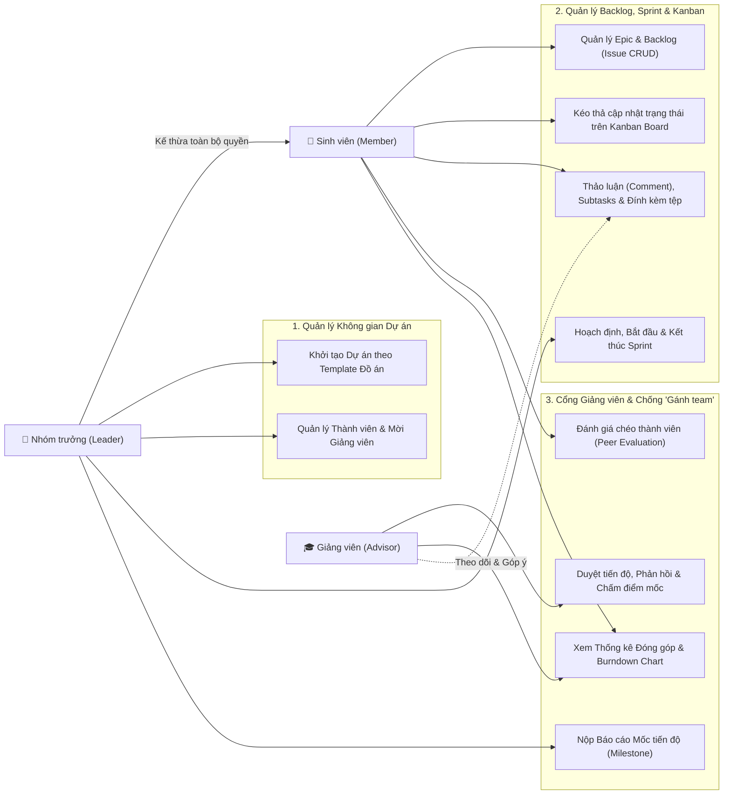
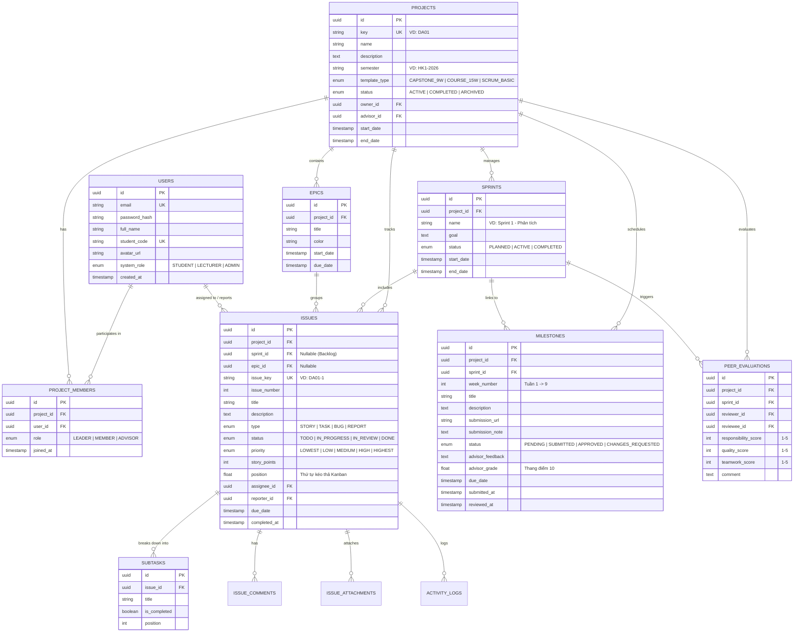

# Tuần 1: Phân Tích Yêu Cầu & Thiết Kế Hệ Thống (SRS & Database Design)

> [!NOTE]
> Tài liệu này được biên soạn theo chuẩn cấu trúc **Chương 2 (Phân tích và Thiết kế hệ thống)** của Báo cáo Đồ án Chuyên ngành. Bạn có thể sử dụng trực tiếp các sơ đồ, bảng biểu và công thức dưới đây vào cuốn báo cáo của mình.

---

## 1. Phân Tích Tác Nhân (Actors) & Ma Trận Phân Quyền (RBAC)

Hệ thống bao gồm **2 cấp độ phân quyền**:
1. **System Role (Vai trò toàn hệ thống):** `STUDENT` (Sinh viên), `LECTURER` (Giảng viên), `ADMIN` (Quản trị viên).
2. **Project Role (Vai trò trong từng dự án đồ án):** `LEADER` (Nhóm trưởng), `MEMBER` (Thành viên), `ADVISOR` (Giảng viên hướng dẫn).

| Nhóm chức năng | Thành viên (`MEMBER`) | Nhóm trưởng (`LEADER`) | Giảng viên (`ADVISOR`) |
| :--- | :---: | :---: | :---: |
| Khởi tạo dự án từ Template (9 tuần / 15 tuần) | ❌ | ✅ | ✅ |
| Mời/Xóa thành viên, Gán Giảng viên hướng dẫn | ❌ | ✅ | ❌ |
| Tạo/Sửa/Xóa Sprint, Bắt đầu & Kết thúc Sprint | ❌ | ✅ | 👁️ (Chỉ xem) |
| Tạo Issue/Task, Kéo thả Kanban, Bình luận, Đính kèm file | ✅ | ✅ | 👁️ (Xem & Nhận xét) |
| Nộp Báo cáo Mốc tiến độ tuần (Milestone Submission) | ❌ | ✅ | ❌ |
| Duyệt Mốc tiến độ, Nhận xét & Chấm điểm giai đoạn | ❌ | 👁️ (Xem kết quả) | ✅ |
| Đánh giá chéo đồng đội cuối Sprint (Peer Evaluation) | ✅ | ✅ | 👁️ (Xem tổng hợp) |
| Xem Dashboard tiến độ & Bảng thống kê đóng góp | ✅ | ✅ | ✅ (Chi tiết) |

---

## 2. Sơ Đồ Use Case & Đặc Tả Nghiệp Vụ Cốt Lõi

### 2.1. Sơ đồ Use Case Tổng quát

### 2.2. Đặc tả 3 Luồng Nghiệp vụ Trọng tâm (Sequence & Logic)

#### A. Luồng Kéo-Thả thẻ công việc trên Bảng Kanban (LexoRank / Floating Position)
Để tránh việc phải cập nhật lại thứ tự của hàng trăm bản ghi trong Database mỗi khi kéo 1 thẻ từ vị trí này sang vị trí khác, hệ thống sử dụng kỹ thuật **Floating-Point Position Indexing**:
* Mỗi Issue trên cột Kanban có trường `position` (kiểu `DOUBLE PRECISION`, mặc định cách nhau `1024.0`: thẻ 1 = `1024`, thẻ 2 = `2048`, thẻ 3 = `3072`).
* Khi kéo Thẻ 3 chèn vào giữa Thẻ 1 và Thẻ 2:
  $$\text{position}_{\text{mới}} = \frac{\text{position}_{\text{trên}} + \text{position}_{\text{dưới}}}{2} = \frac{1024 + 2048}{2} = 1536$$
* Nhờ vậy, mỗi thao tác kéo thả **chỉ cần đúng 1 câu lệnh `UPDATE` duy nhất** vào Database và phát sự kiện qua `Socket.io` tới các thành viên khác trong nhóm.

#### B. Luồng Nộp & Duyệt Mốc Báo Cáo Tuần (Milestone Review)
1. Khi tạo dự án theo **Template Đồ án 9 tuần**, hệ thống tự động sinh sẵn 9 mốc `Milestone` (Tuần 1 $\rightarrow$ Tuần 9) tương ứng với kế hoạch đồ án.
2. Cuối mỗi tuần/Sprint, **Nhóm trưởng** đính kèm link/file báo cáo, chọn các Issue đã hoàn thành trong tuần và bấm **"Nộp báo cáo (Submit Milestone)"**.
3. **Giảng viên hướng dẫn** nhận thông báo, kiểm tra danh sách công việc thực tế các thành viên đã làm, nhập nhận xét (`advisor_feedback`), cho điểm quá trình (`grade`) và chọn trạng thái:
   * `APPROVED` (Đạt tiến độ)
   * `CHANGES_REQUESTED` (Yêu cầu bổ sung/chỉnh sửa)

#### C. Thuật toán Tính Điểm Đóng Góp Cá Nhân (Chống "Free-rider / Gánh team")
Điểm đóng góp của mỗi sinh viên $i$ trong dự án ($S_i$, thang điểm 100) được tính tự động từ **3 chỉ số khách quan & định tính**:

$$S_i = 0.50 \times P_i + 0.30 \times T_i + 0.20 \times R_i$$

Trong đó:
1. **$P_i$ (Tỷ lệ Khối lượng Story Points hoàn thành - Trọng số 50%):**
   $$P_i = \min\left(100, \frac{\text{Tổng Story Points đã DONE của SV } i}{\text{Trung bình Story Points kỳ vọng mỗi SV}} \times 100\right)$$
2. **$T_i$ (Tỷ lệ Hoàn thành đúng hạn / On-time Rate - Trọng số 30%):**
   $$T_i = \frac{\text{Số Issue DONE có } \texttt{completed\_at} \le \texttt{due\_date}}{\text{Tổng số Issue đã được giao cho SV } i} \times 100$$
3. **$R_i$ (Điểm Đánh giá chéo trung bình từ đồng đội / Peer Review - Trọng số 20%):**
   $$R_i = \frac{\text{Trung bình cộng điểm (Trách nhiệm + Chất lượng + Phối hợp) trên thang 5}}{5} \times 100$$

> [!TIP]
> Hệ thống tự động gắn cảnh báo **"⚠️ Nguy cơ Free-riding (Đóng góp thấp)"** trên Dashboard của Giảng viên nếu một thành viên có tổng Story Points hoàn thành thấp hơn **40%** mức trung bình của cả nhóm.

---

## 3. Thiết Kế Cơ Sở Dữ Liệu (ERD & Schema PostgreSQL)

### 3.1. Sơ đồ Thực thể Kết hợp (ERD)

---

## 4. Thiết Kế Giao Diện (UI/UX Wireframe Định Hướng)

Hệ thống gồm **5 màn hình cốt lõi** cần xây dựng ở Frontend:
1. **Project Overview & Contribution Dashboard:** Hiển thị thẻ thống kê nhanh, Biểu đồ Burndown Chart của Sprint hiện tại, và **Bảng xếp hạng đóng góp thành viên** (kèm cảnh báo thành viên ít đóng góp).
2. **Backlog & Sprint Planning View:** Chia làm 2 nửa trên/dưới giống Jira — phía trên là danh sách các Sprint (có nút `Start Sprint` / `Complete Sprint`), phía dưới là danh sách `Backlog` chờ kéo lên Sprint.
3. **Active Sprint Kanban Board:** 4 cột (`TO DO`, `IN PROGRESS`, `IN REVIEW`, `DONE`), mỗi thẻ hiển thị mã (`DA01-12`), tiêu đề, nhãn độ ưu tiên, badge `Story Points`, hạn chót và Avatar người phụ trách.
4. **Issue Detail Drawer / Modal:** Mở trượt từ bên phải hoặc giữa màn hình khi click vào thẻ công việc, cho phép sửa mô tả, tích chọn Sub-tasks, bình luận và xem lịch sử hoạt động.
5. **Advisor Milestone & Peer Review Portal:** Giao diện lộ trình 9 tuần của đồ án (Timeline), nơi Nhóm trưởng đính kèm báo cáo tuần và Giảng viên hướng dẫn vào chấm điểm, nhận xét.
